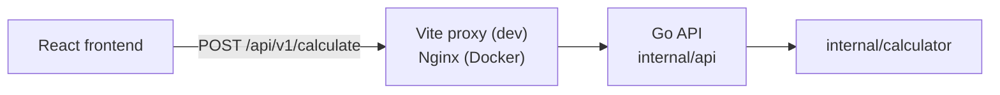

# Calculator Sezzle

A full-stack calculator: a React + TypeScript frontend that consumes a Go REST API. The frontend only collects input and shows results; every calculation is done by the backend.

Supported operations: addition, subtraction, multiplication, division, and the optional exponentiation, square root and percentage.

## Requirements

- [Docker](https://docs.docker.com/get-docker/) with Docker Compose v2 (`docker compose`), to run everything together
- To run without Docker: [Go](https://go.dev/dl/) 1.27.2 or newer and [Node.js](https://nodejs.org/) 22 or newer

## How to run

### With Docker Compose (recommended)

From the project root:

```bash
docker compose up --build
```

- Calculator: http://localhost:3000
- API: http://localhost:8080

Each image build runs its tests first, so the build fails if any test fails. The frontend starts once the backend's health check passes. Stop everything with `Ctrl+C`, or use `docker compose up --build -d` and `docker compose down`.

### Without Docker

Run the backend and the frontend in two terminals:

```bash
# Terminal 1: API on http://localhost:8080
cd backend
go run ./cmd/server
```

```bash
# Terminal 2: calculator on http://localhost:5173
cd frontend
npm install
npm run dev
```

The Vite dev server forwards `/api` requests to the backend on port 8080.

## Tests and coverage

```bash
# Backend
cd backend
go test -cover ./...
go test -coverprofile=coverage.out ./... && go tool cover -html=coverage.out -o coverage.html

# Frontend (HTML report in frontend/coverage/index.html)
cd frontend
npx vitest run
npm run coverage
```

Current coverage:

| Layer | Package | Coverage (statements) |
| --- | --- | --- |
| Backend | `internal/calculator` (arithmetic) | 100% |
| Backend | `internal/api` (HTTP, validation) | 91.7% |
| Frontend | All files (137 tests) | 95.3% (97.1% lines) |

The backend entry point (`cmd/server`) only wires things together and has no tests.

## API

| Method | Path | Description |
| --- | --- | --- |
| `GET` | `/health` | Health check, returns `{"status":"ok"}` |
| `POST` | `/api/v1/calculate` | Performs one calculation |

The request body is JSON with `operation`, `a` and, except for `sqrt`, `b`.

| `operation` | Result |
| --- | --- |
| `add` | `a + b` |
| `subtract` | `a - b` |
| `multiply` | `a * b` |
| `divide` | `a / b` |
| `power` | `a` to the power of `b` |
| `sqrt` | Square root of `a` (no `b`) |
| `percentage` | `b` percent of `a` (`a * b / 100`) |

### Examples

```bash
curl -X POST http://localhost:8080/api/v1/calculate \
  -H "Content-Type: application/json" \
  -d '{"operation": "add", "a": 2, "b": 3}'
# 200 {"result":5}

curl -X POST http://localhost:8080/api/v1/calculate \
  -H "Content-Type: application/json" \
  -d '{"operation": "sqrt", "a": 16}'
# 200 {"result":4}

curl -X POST http://localhost:8080/api/v1/calculate \
  -H "Content-Type: application/json" \
  -d '{"operation": "divide", "a": 1, "b": 0}'
# 400 {"error":"cannot divide by zero"}
```

### Errors

Invalid input returns status `400` with an `error` message:

| Case | `error` |
| --- | --- |
| Malformed JSON or unknown fields | `JSON is invalid` |
| Missing `operation`, `a` or `b` | `the field '<name>' is necessary` |
| Unsupported operation | `unknown operation` |
| Division by zero | `cannot divide by zero` |
| Square root of a negative number | `cannot take the square root of a negative number` |
| Result is NaN or infinite (e.g. a huge `power`) | `result is not defined` |

## Using the calculator

It works like a basic pocket calculator, with the mouse, touch or keyboard (click the calculator or press Tab to give it focus).

| Keyboard | Key |
| --- | --- |
| `0`–`9`, `.` | Digits and decimal point (up to 12 digits) |
| `+` `-` `*` `/` `^` | Add, subtract, multiply, divide, power |
| `r` | Square root |
| `%` | Percentage |
| `Enter` or `=` | Equals |
| `Backspace` | Delete last digit |
| `Escape` | Clear all |

- `=` again repeats the last operation (`5 × 2 = =` gives `20`), and `=` with no second number reuses the displayed one (`5 × =` gives `25`).
- `%` works like on a phone: `200 + 10 %` gives `20` (10% of 200), then `=` gives `220`. On its own, `50 %` gives `0.5`.
- Errors from the API (such as division by zero) and network failures are shown on the display; the next digit or `AC` clears them.

## Design decisions

### Architecture



- **The backend does all the arithmetic.** The frontend never computes a result; it only decides which operation to send. There is one source of truth for results and edge cases, and the frontend really consumes the API, as the assignment asks.
- **One endpoint with an `operation` field** instead of one endpoint per operation. Every operation shares one validation path, and adding an operation is a single case in the backend.
- **Same origin for page and API.** In development the Vite proxy forwards `/api`; in Docker, Nginx serves the built frontend and proxies `/api` to the backend. The browser never makes a cross-origin request. CORS on the backend only allows `http://localhost:5173`, for calling the API directly during development.

### Backend (Go)

- **Go with [chi](https://github.com/go-chi/chi)** for routing: close to the standard library, with little extra to learn.
- **Logic separated from HTTP:** `internal/calculator` holds the arithmetic and `internal/api` handles HTTP and validation, so each is tested on its own.
- **Strict validation:** `a` and `b` are pointers, so a missing field is not confused with `0`. Unknown JSON fields are rejected, request bodies are limited to 1 MB, and NaN or infinite results are returned as errors instead of invalid JSON.

### Frontend (React + TypeScript)

- **Three layers:** pure calculator logic (a reducer, formatting, key mapping), an API client, and the UI (a hook plus presentational components). The logic has no React and no `fetch`, so most behavior is covered by fast unit tests.
- **Pure reducer, side effects in one hook.** When a calculation is needed, the reducer records a pending request in its state; the `useCalculator` hook sends it to the API and feeds the answer back. Input is ignored while a request is in flight, and requests time out after 5 seconds.
- **Tailwind CSS** for styling, with a single-column layout that fits phone screens.

### Docker

- **Multi-stage builds** for both services: tests run in the build stage, and only the compiled output goes into a small runtime image.
- **Non-root at runtime:** the backend runs as an unprivileged user and the frontend uses `nginx-unprivileged`.
- **Startup order:** the frontend waits for the backend's `/health` check to pass.

## Assumptions and limitations

- **No operator precedence** (see left-to-right evaluation above). Supporting it would mean sending whole expressions to the backend and parsing them there.
- **Negative numbers only as the first operand.** `-` starts a negative number at the beginning, but after an operator it replaces that operator, so `5 × -2` can't be typed.
- **Floating-point numbers:** results are 64-bit floats, so `0.1 + 0.2` gives `0.30000000000000004`, which the display rounds to about 12 significant digits.
- **One request per step:** each operation needs a round trip to the API, which is fine locally but would feel slow on a high-latency network.

## AI usage

- **Backend (Go):** written by me, using an AI assistant to learn Go, chi and Docker. The prompts are listed below.
- **Frontend (React + TypeScript):** implemented by Claude Code (Claude Opus 5.5) from a plan I wrote: the architecture (three layers, a pure reducer, no arithmetic in the frontend), the calculator behavior rules and the build steps. It worked one step at a time, writing the tests first for the logic. After each step I reviewed the changes and the test results, ran the app, and made the commit myself.

## Prompts

1. (2026-10-19 14:43) Suggest me different architectures for a Calculator application with backend in Go and fron with React
2. (2026-10-19 14:50) From a Python developer point of view. What are the best approaches to do a Go application based on familiarity, ease of use and complexity given the calculador API scope? Make a comparison of the base library and frameworks
3. (2026-10-19 15:16) Search for guides and tutorials on how to use chi to make and API
4. (2026-10-19 17:06) How does go works without classes? What's the equivalent in Python?
5. (2026-10-19 17:08) What is the operator := ?
6. (2026-10-19 17:27) For go version 1.27.2 create a Dockerfile and update docker-compose.yml
7. (2026-10-19 19:18) I have these ideas for the calculator usage. Summarize and update the README where necessary
8. (2026-10-19 18:49) This is my logic for the calcultator. Click and type are treated the same, suppose I write both. I click a number, it gets render (suppose 5) in the screen of the calculator
  I click and operation (suppose *) , it gets highlighted.
  If I click another operation it changes to that (suppose +)
  If i type another number (suppose 2) the operation is made and it renders on screen the result (assuming * is highlighted 10 is rendered)
  If I click equal it uses the same number as the other name (assuming * is highlighted 25 is rendered). Am I missing anything?
9. (2026-10-19 19:15) Give me a summary of the calculator operations and logic
10. (2026-10-19 19:19) Update the README.md file where necessary
11. (2026-10-20 04:28) Started a Claude Code session to implement the frontend from a plan I deviced. The session followed the plan step by step: after each step I reviewed the result and made some adjustments. Those follow-up messages are short and only make sense next to the code they refer to, so they are not listed individually.
